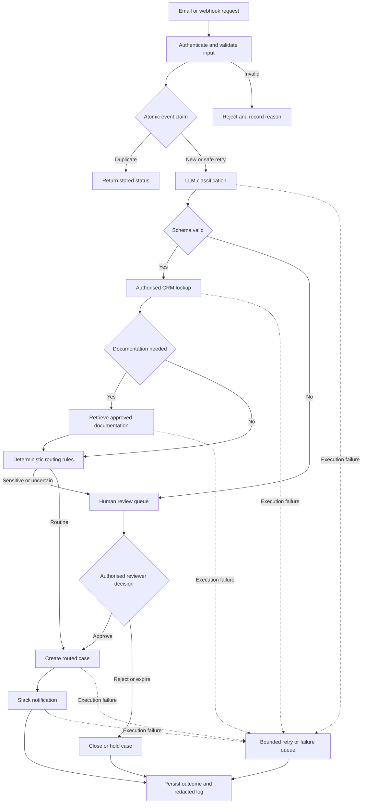

# AI Customer Support Orchestration

| Development status | Scope |
| --- | --- |
| **Planned** | Proposed showcase; no workflow implementation or runtime results yet |

A planned orchestration workflow for classifying SaaS support requests, retrieving relevant context and routing cases with human oversight.

This repository contains a proposed technical case study. The business scenario is illustrative, not a completed client engagement. Integrations, exports, tests and demos are not available yet.

[GitHub profile](https://github.com/oleafm) · [Maintenance guide](docs/maintenance.md)

## Business problem

A subscription-based SaaS company receives billing, technical, account-access and product questions. Staff need consistent triage and relevant context without allowing AI to make sensitive account or financial decisions.

## Proposed solution

Use Make.com to validate and deduplicate incoming requests, ask an LLM for structured classification, retrieve authorised customer and documentation context, and apply explicit routing rules. Sensitive or uncertain cases would wait for human review.

The workflow would triage and route support cases. Refunds, subscription changes, account recovery and disclosure of sensitive information would require an authorised human and a separately defined process. Automated customer replies are outside the initial scope.

## Planned technology stack

| Role | Planned technology |
| --- | --- |
| Orchestration | Make.com |
| Classification | OpenAI API with structured JSON output |
| Business context | REST APIs and a CRM; provider to be selected |
| Documentation retrieval | Approved product documentation; RAG approach to be evaluated |
| Notifications | Slack |
| Optional persistence | Supabase; a durable state-store choice remains open |

These tools describe the intended project stack, not completed integrations or an established commercial track record with every technology.

## Proposed architecture

All components and paths are proposed. The diagram summarises the main flow; validation and persistence failures would fail closed as described in the detailed design.

[Architecture decisions and data contracts](docs/architecture.md) · [Editable Mermaid source](diagrams/architecture.mmd)

## Planned workflow capabilities

1. Receive email or webhook requests and normalise the event envelope.
2. Validate required fields and prevent duplicate processing.
3. Classify intent, priority and sentiment using an LLM.
4. Validate structured JSON against an explicit output contract.
5. Retrieve authorised customer information from a CRM.
6. Retrieve relevant product documentation when required.
7. Route requests through deterministic business rules.
8. Hold sensitive requests for human approval.
9. Notify the appropriate Slack channel with minimal context.
10. Record execution outcomes and failures for controlled recovery.

## Technical challenges to address

- Separating model classification from permission to take action.
- Preventing customer text and retrieved documents from overriding trusted instructions.
- Retrieving useful documentation while preserving customer and tenant boundaries.
- Handling repeated deliveries and retries without duplicate notifications or case actions.

## Security and reliability considerations

Input validation, scoped credentials, idempotency, bounded retries and authenticated human review are planned requirements. Model output would remain untrusted until validated, and business rules would control downstream actions.

[Security boundaries and data handling](docs/security.md) · [Recovery and execution design](docs/architecture.md)

## Implementation progress

- [ ] Workflow implemented
- [ ] API connections configured
- [ ] Error handling implemented
- [ ] Synthetic test data prepared
- [ ] Tests executed
- [ ] Workflow export sanitised
- [ ] Architecture verified
- [ ] Demo video recorded
- [ ] Case study finalised

[Build sequence and open decisions](docs/implementation.md) · [Status definitions](docs/maintenance.md)

## Testing and evaluation

No workflow tests have been executed and no performance results are claimed. The [testing plan](docs/testing.md) defines synthetic cases, expected outcomes and evidence to collect once implementation exists.

## Demo and source files

| Artifact | Current availability |
| --- | --- |
| Demo video | **Placeholder — not recorded; add a real URL later** |
| Architecture | Proposed Mermaid above; [source](diagrams/architecture.mmd) |
| Workflow exports | None; [export instructions](workflows/README.md) |
| Prompts | None; [prompt plan](prompts/README.md) |
| Synthetic test data | Not prepared; [dataset plan](sample-data/README.md) |
| Screenshots | None; [evidence instructions](screenshots/README.md) |

## Future improvements

- Evaluate retrieval quality using a versioned synthetic knowledge base.
- Compare classification performance across prompt and model versions.
- Add richer observability after the initial workflow and failure paths are validated.

Future ideas are outside the initial evidence claims and may change after the first implementation.
